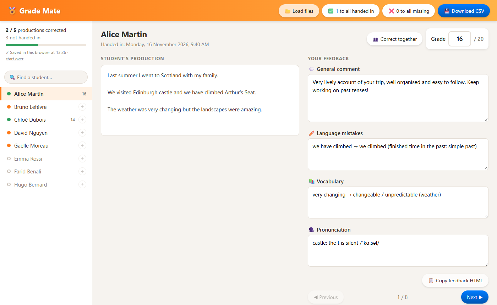
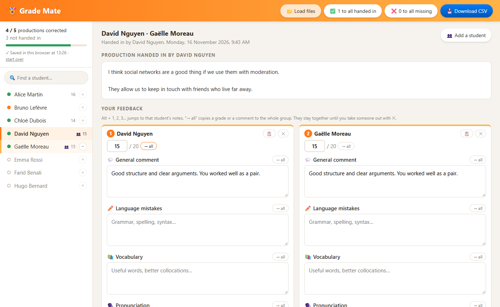
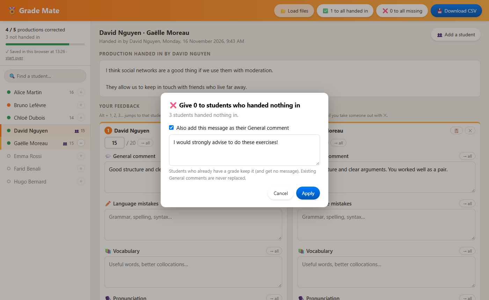

# 🏅 Grade Mate

Grade Mate helps you grade a Moodle assignment one student at a time, without clicking through Moodle for each one. You load Moodle's grading worksheet (and, if you like, the submissions ZIP). Then you read each production, type a grade and structured feedback, and download a CSV to upload back into Moodle.

It's a single web page. Nothing to install and no account. Your students' work never leaves your computer.

## How it works

### 1. Get the files from Moodle

In the assignment settings, under **Feedback types**, tick **Feedback comments** and **Offline grading worksheet**.

Then, on the assignment's submissions page:

- **Download grading worksheet** gives you the `.csv` (required).
- **Download all submissions** gives you a `.zip` (optional). Load it when students uploaded files or when you want their online text with its original formatting and images.

### 2. Load them into Grade Mate

Open `index.html` in your browser. Drop the CSV and the ZIP onto the page, or click **choose the files**. You can load both at once. The app understands both English and French Moodle exports.

### 3. Correct, student by student

The list on the left puts the students who handed something in first. Each one is marked with a coloured dot:

- 🟠 to correct
- 🟢 corrected (has a grade or feedback)
- ⚪ nothing handed in

For each student you see:

- **Their production**: the online text, or the HTML from the ZIP with its images. Attached files appear as download buttons below it, and links in the text become clickable buttons.
- **Recordings**: Vocaroo and Linguabot links, and links to audio files, open in a player right on the page. You can play them at ×1, ×1.5 or ×2 speed.
- **Your feedback**, in four fields: 💬 General comment, ✏️ Language mistakes, 📚 Vocabulary and 🗣️ Pronunciation. Empty fields are left out of what the student sees.
- **The grade**, out of the assignment's maximum.

A 🔄 next to a name means the student changed their work after it was last graded.

**Shortcuts**

| Keys | Does |
| --- | --- |
| Alt + ↓ / ↑ | Next / previous student |
| Type in 🔍 Find a student, then Enter | Open the first match |
| Shift + Enter in the search box | Add that student to the one you're correcting |
| Ctrl + click a name | Add that student to the one you're correcting |
| Alt + 1, 2, 3… | In a group, jump to that student's feedback |

### 4. Correct a group together

When several students worked on the same production, click **👥 Correct together**. Then click **+** next to each of their partners. The production stays on top, and each student gets their own grade and feedback card. Use **→ all** to copy a grade or a comment to the whole group. To take someone out of the group, click **✕**.

### 5. Grade the rest in one click

- **✅ 1 to all handed in** gives 1 to every student who handed something in and has no grade yet. This is handy for completion-only tasks.
- **❌ 0 to all missing** gives 0 to everyone who handed nothing in. It can also add a message to their General comment.

Neither button touches a grade you've already entered or replaces an existing General comment.

### 6. Send it back to Moodle

Click **💾 Download CSV**, then go to the assignment in Moodle and choose **Upload grading worksheet**.

The CSV only contains the students whose grade or feedback you changed. Moodle therefore leaves everyone else exactly as it was. The feedback is written as nicely formatted HTML, with one heading per field.

If you'd rather paste feedback straight into Moodle, **📋 Copy feedback HTML** copies the current student's feedback, ready to paste.

## Your work is saved as you go

Grades and comments are saved in your browser while you type. If you close the tab, drop the same CSV back in later and you'll pick up where you left off. To discard everything typed since loading the CSV, click **start over** under the progress bar.

This save lives only in this browser on this computer. The CSV you download is what counts.

## Privacy

Everything happens in your browser. The CSV and the submissions are read locally and are never uploaded anywhere. The only thing the page fetches from the internet is the [JSZip](https://stuk.github.io/jszip/) library, used to open the ZIP. Recordings are streamed from Vocaroo or Linguabot when you play them.
